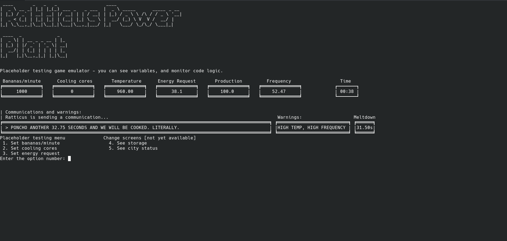

# Ratticus Power Plant
At terminal game with browser-based story intro. You play as the operator of Terra Town power plant. Keep temperature and grid frequency under control and listen to Ratticus, who will not stay calm.

## Screenshots

## Why and how I made it
I made it because this week in Terra, Ratticus is starting a power plant powered by bananas! So i thought: "Why not make the power plant itself?" and RPP was born.
I made it in Python and learned some Javascript in the meanwhile!

## How to play
The game starts a short story in your browser, close the page and the game continues in the terminal. You have a live dashboard that shows the state of the plant, and a menu that lets you change parameters. Changes are applied after 2 seconds, so plan ahead.

### Goals
- Keep the frequency at 50 Hz. It rises when you produce more than the city needs and drops when you produce less.
- Keep the temperature under control (stay below 550 °C).
- Follow the energy request, which changes during the day from 25 MW to 150 MW, with a lunch peak around 11:30 and a bigger one at 21:00.

### Game over

If the temperature or the frequency goes out of the safe range, a 60-second countdown starts. If you don't fix it in time, the plant explodes and the game ends.
## Installing and running

1. Go to the releases page
2. Download the .exe file
3. Run the .exe file
    
#### OS support

Ratticus Power Plant only runs with Windows, however, you can run RPP on MacOS and Linux by cloning the repo, downloading the dependencies and running main.py.
